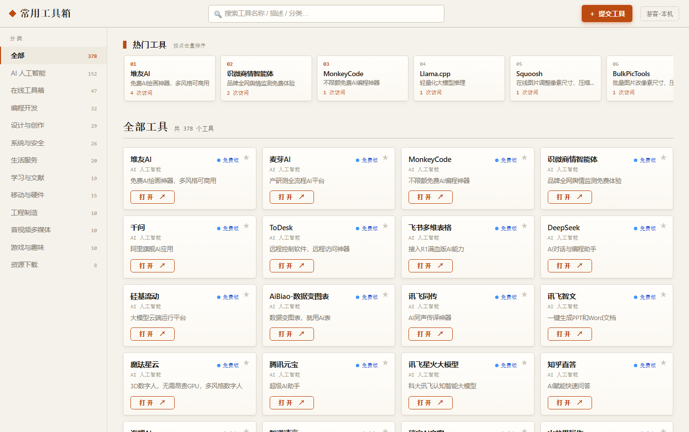
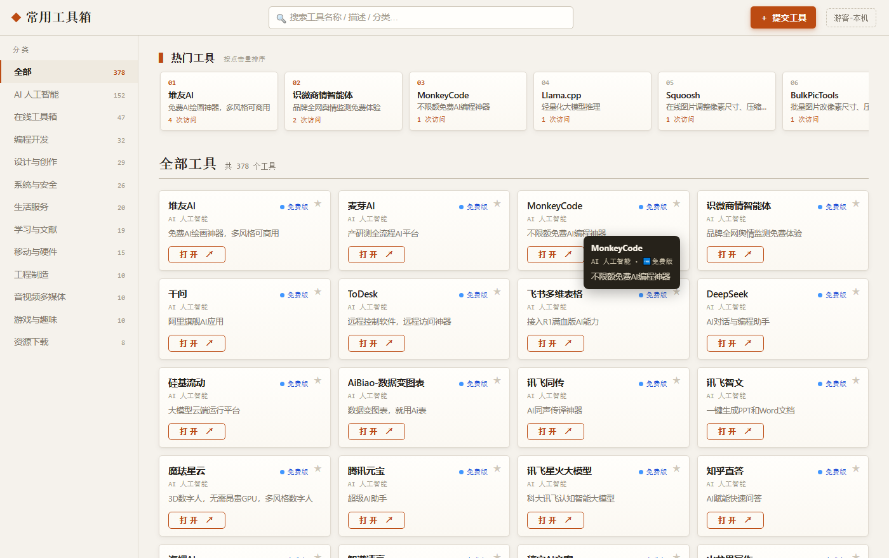
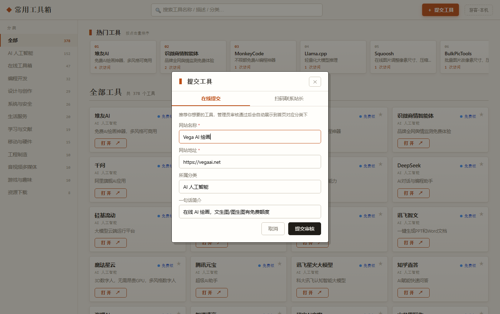
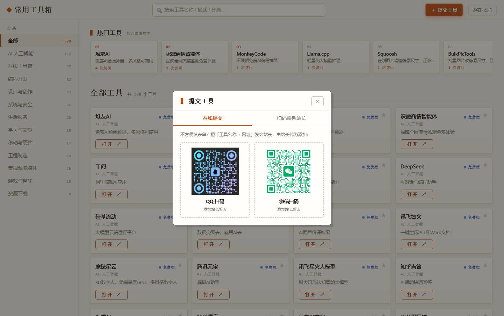
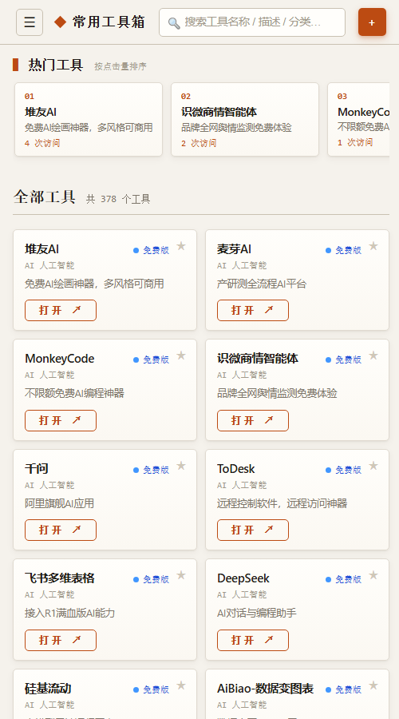
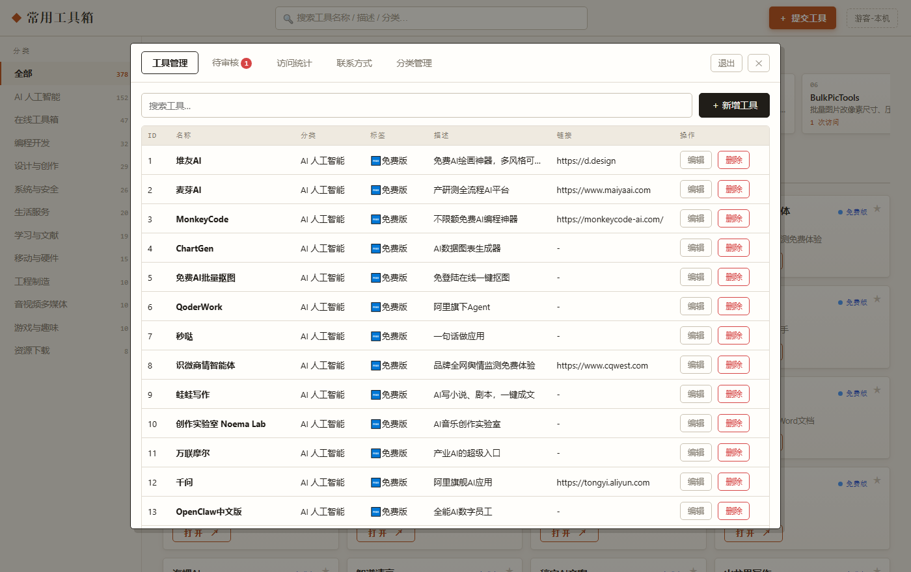
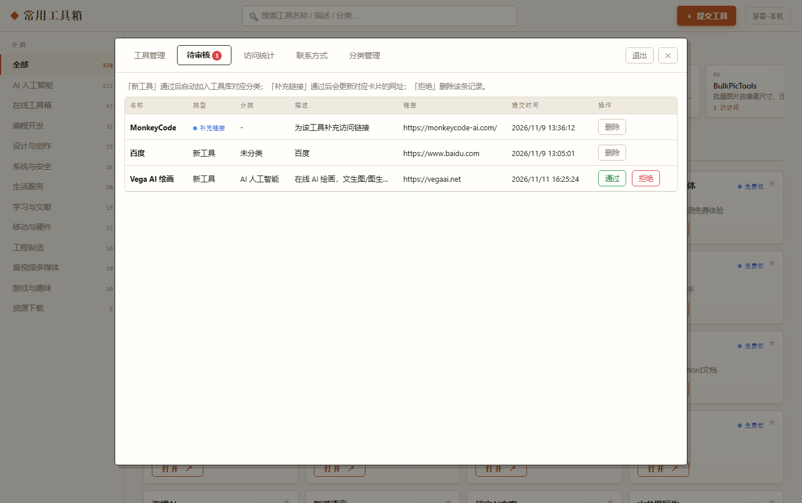
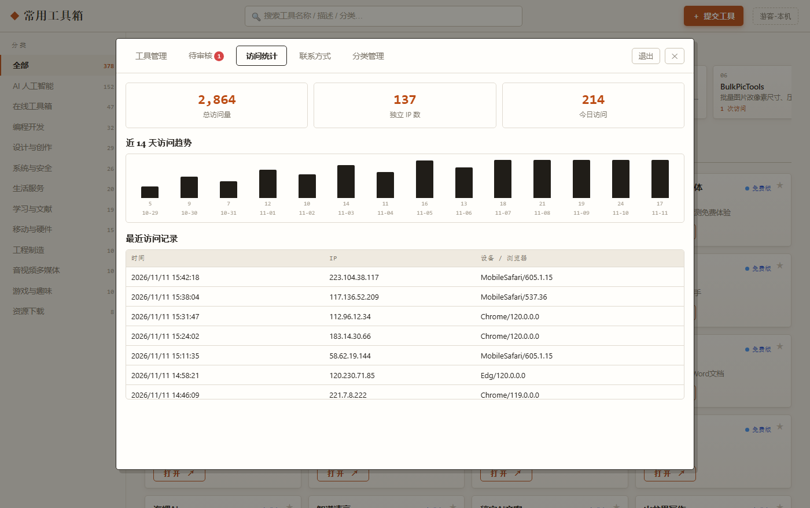

# Online Tools Site · 常用工具箱

[简体中文](README.md) | **English**

A self-hostable **tool navigation site**: a clean front page for visitors to find tools, and a full admin panel for the site owner to manage content.

Zero dependencies (no Express, no database) — everything is stored as JSON files. It runs comfortably on a 1-core VPS.



## Features

**Front page**

- Category sidebar (collapsible drawer on mobile) and instant top-bar search
- Card grid with color-coded tags: open-source & free / free tier / trial
- Hovering a card pops up its name, category, tag and description right under the cursor
- The whole card is clickable — no need to aim at a tiny button
- 🔥 Popular tools ranked by real click counts
- Favorites & user identity (IP + localStorage, no signup)
- Tools without a URL are dimmed and pushed to the end of their category; anyone can submit the missing link via "＋ Supplement link", which goes live after admin review
- "Submit a tool" supports an online form, or switch to the "Scan to contact" tab and add the site owner by QR code
- QR code display area is adjustable in the admin panel (fit / zoom / horizontal & vertical offset); default is untouched

**Admin panel** (hidden entrance + login)

- Full tool CRUD; the category dropdown automatically includes pre-created empty categories
- Category management: create, rename (syncs every card), delete (with card migration or purge, double-click confirm)
- Review center: approve or reject user-submitted tools and link supplements with one click
- Analytics: total visits, unique IPs, today's visits, 14-day trend, recent visit log
- QR code upload: QQ / WeChat, up to 3MB; the front page hides missing QR cards automatically
- Content changes go live instantly — no server restart needed (`no-store` APIs + negotiated caching for static files)

**Security**

- Admin password stored as salted SHA-256; legacy plaintext passwords are upgraded automatically on first login
- Login rate limiting: 5 consecutive failures per IP → 10-minute ban
- Session tokens live in memory only, expire after 2 hours, and are wiped on restart

## Screenshots

| Hover tooltip | Submit a tool |
|---|---|
|  |  |

| Scan to contact | Mobile |
|---|---|
|  |  |

| Admin tools | Review center |
|---|---|
|  |  |



## Quick start

Requires Node.js 14+ (20 LTS recommended). No `npm install` needed.

```bash
git clone https://github.com/mbc27/online-tools-site.git
cd online-tools-site
node server.js
```

Open http://localhost:3000 . On first start the server creates the `data/` directory and imports initial tools from `清单.json` (delete the file to start from an empty library).

Default admin account: `admin` / `admin123` — **change it immediately after deploying**.

## Admin entrance (any of these)

1. Click the site title **5 times** within 2 seconds
2. Shortcut **Ctrl + Alt + A**
3. Append **#admin** to the URL

## Changing the admin password

Edit `data/config.json`, put your new plaintext password in `password`, restart the server, then log in once — the server converts it into a salted hash automatically and no plaintext remains on disk.

```json
{
  "username": "your-name",
  "password": "your-strong-password"
}
```

## Deploying to a server

1. Upload `server.js`, `package.json`, `public/`, `清单.json` (the `data/` directory is generated automatically; copy it over to migrate existing data)
2. Keep it alive with PM2:

```bash
npm i -g pm2
PORT=3000 pm2 start server.js --name tools-site
pm2 save && pm2 startup
```

3. Reverse proxy with Nginx + HTTPS:

```nginx
server {
    listen 80;
    server_name your-domain.com;
    location / {
        proxy_pass http://127.0.0.1:3000;
        proxy_set_header X-Real-IP $remote_addr;
        proxy_set_header X-Forwarded-For $proxy_add_x_forwarded_for;
    }
}
```

Run `certbot --nginx` for a free certificate. Only expose ports 80/443 — never expose 3000 directly.

## Project layout

```
.
├── server.js              # Zero-dependency HTTP server + all API routes
├── public/
│   ├── index.html         # Front page + admin panel markup
│   ├── app.js             # Frontend logic (render/search/favorites/submissions)
│   ├── admin.js           # Admin logic (CRUD/review/stats/categories/QR)
│   └── style.css          # Site-wide styles
├── 清单.json               # Initial tool data (imported on first start, deletable)
├── data/                  # Runtime data, auto-generated, git-ignored
│   ├── tools.json         # Tools
│   ├── categories.json    # Pre-created empty categories
│   ├── submissions.json   # User submissions (pending / approved)
│   ├── stats.json         # Visit stats & click counts
│   ├── config.json        # Admin account (hashed password)
│   └── qr-*.png           # Site owner QR codes
└── docs/screenshots/      # README images
```

## API overview

| Method | Path | Description |
|---|---|---|
| GET | `/api/overview` | Tool list, popular ranking, site stats (public) |
| GET | `/api/categories` | Categories with counts, incl. empty ones |
| GET | `/api/qr-config` | QR display settings (public) |
| POST | `/api/submit` | Submit a new tool |
| POST | `/api/suggest-url` | Supplement a missing link |
| POST | `/api/login` | Admin login, returns a Bearer token |
| GET/POST/PUT/DELETE | `/api/tools` | Tool CRUD (auth required) |
| GET/POST | `/api/submissions`, `/api/submissions/approve` | Review list & approve/reject (auth required) |
| POST/PUT/DELETE | `/api/categories` | Create / rename / delete categories (auth required) |
| GET | `/api/stats` | Visit analytics (auth required) |
| POST/DELETE | `/api/qr`, `/api/qr-config` | QR code & display settings management (auth required) |

## Notes

- The `data/` directory contains the admin password hash and visitor data — **never commit it** (already in `.gitignore`)
- Data lives in plain JSON files without locking; fine for personal / small-team sites, not for heavy concurrent writes
- Backing up the whole `data/` directory is a complete backup

## Contributing

Issues and pull requests are welcome! Bug reports should include reproduction steps and the environment (see the issue templates). CI runs syntax checks and a smoke test on every push.

## License

[MIT](LICENSE)
