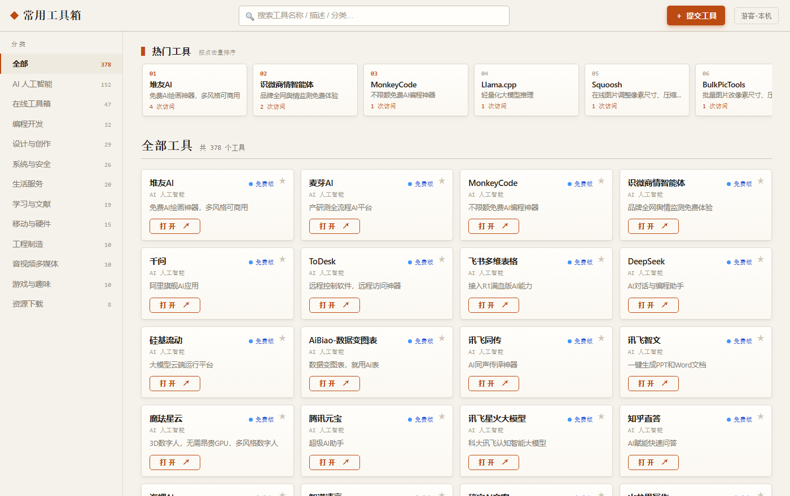
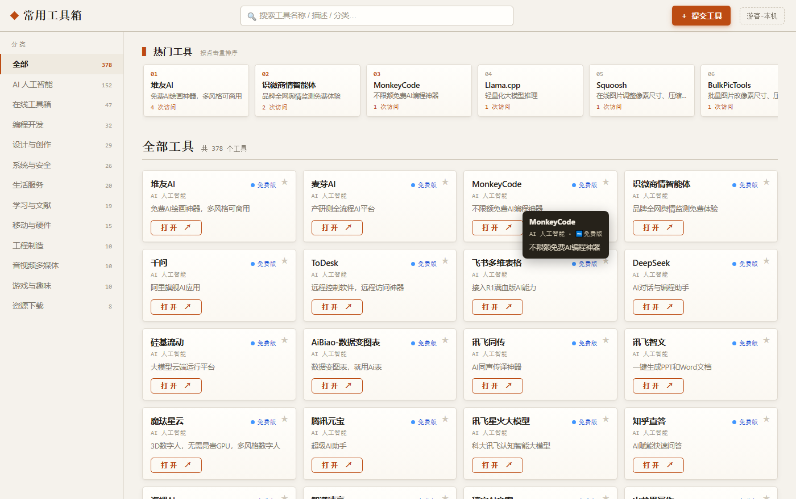
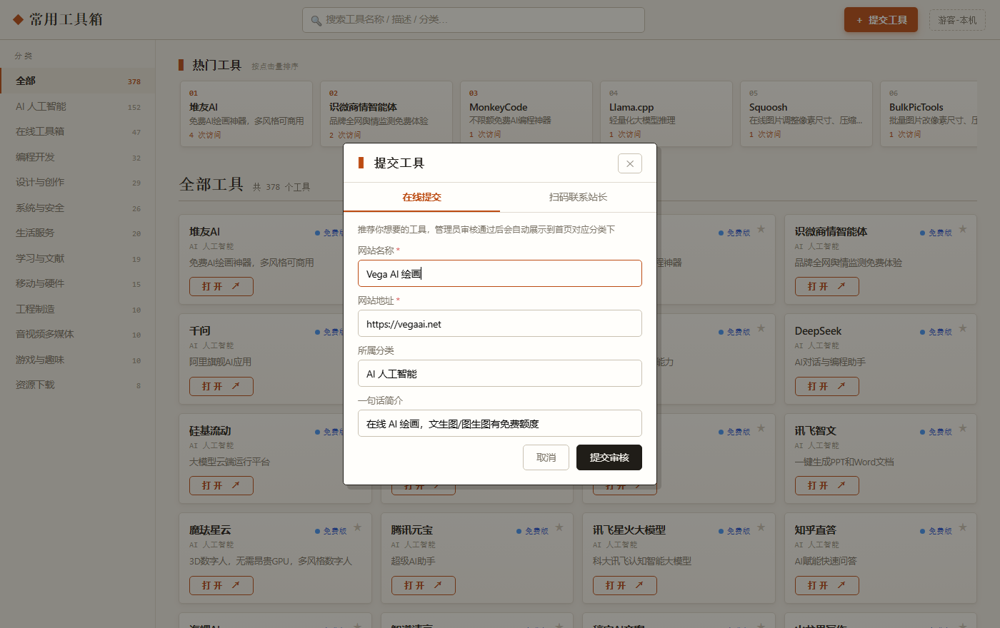
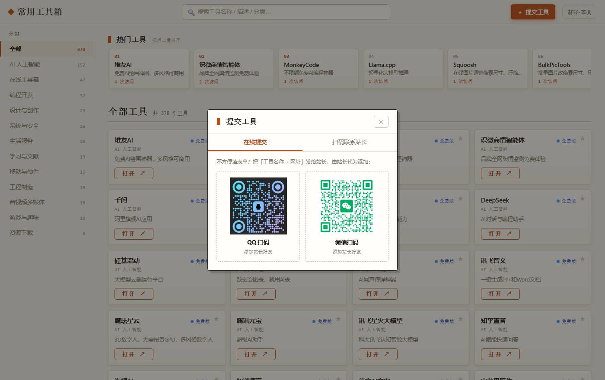
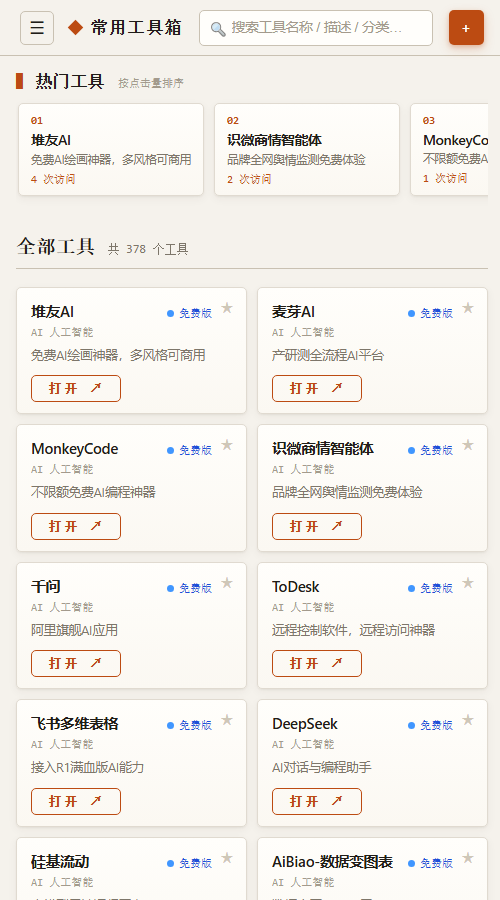
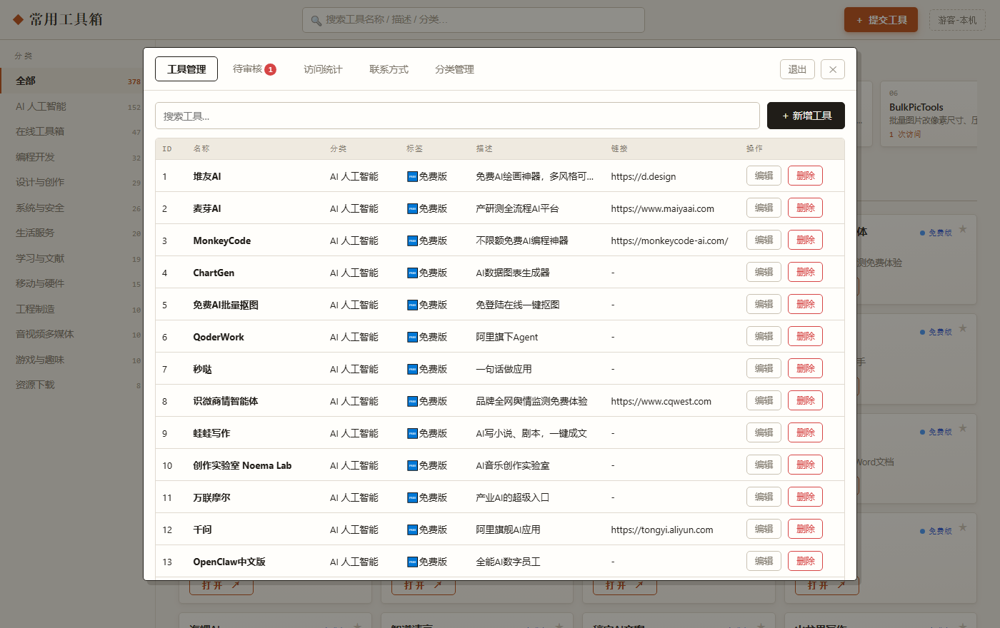
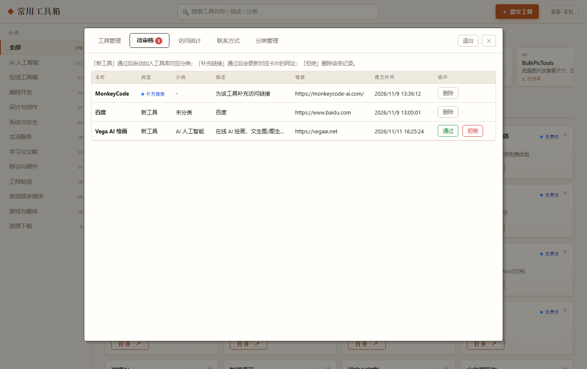
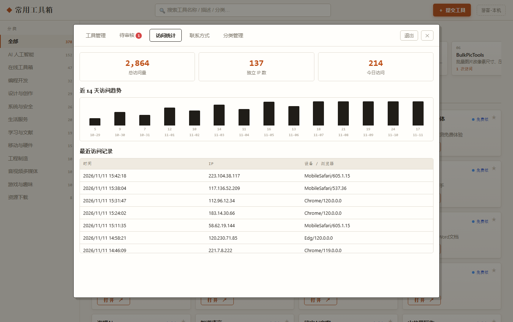

# 常用工具箱 · Online Tools Site

**简体中文** | [English](README.en.md)

一个可以自己部署的**工具导航站**：前台给用户找工具，后台给站长管内容。

零依赖（不用 Express、不用数据库），数据全部存成 JSON 文件，一台 1 核小机器就能跑。



## 特性

**前台**

- 左侧分类侧边栏（移动端收进抽屉），顶部实时搜索，输入即筛选
- 卡片网格，标签按类型着色：开源免费 / 免费版 / 限时试用
- 鼠标悬停在卡片上，光标下方浮出该工具的名称、分类、标签与简介
- 整张卡片可点击打开，无需瞄准小按钮
- 🔥 热门工具榜按真实点击量排序
- 收藏功能、用户身份（基于 IP + localStorage，免注册）
- 无链接的卡片整体灰显并排到分类末尾，任何人都能「＋ 补充链接」提交网址，站长审核通过后自动归位
- 「提交工具」支持在线填写表单，或切到「扫码联系站长」直接扫码加好友推荐
- 站长二维码可在后台实时调整显示区域（适应方式 / 缩放 / 水平垂直偏移），默认不做任何裁剪

**后台**（隐藏入口 + 登录）

- 工具增删改查，分类下拉自动包含预建的空分类
- 分类管理：新增、重命名（同步更新其下所有卡片）、删除（有卡片时可选全部迁移到其他分类或连同卡片删除，双击确认防误删）
- 审核中心：用户提交的新工具 / 补充链接，一键通过或拒绝，通过后自动入库
- 访问统计：总访问量、独立 IP、今日访问、近 14 天趋势、最近访问明细
- 二维码上传：QQ / 微信，≤3MB，未上传时前台自动隐藏并给兜底提示
- 修改内容即时生效，无需重启服务（接口 `no-store`、静态资源协商缓存）

**安全**

- 管理员密码加盐 SHA-256 哈希存储，旧明文密码在首次登录后自动升级
- 登录失败限速：同一 IP 连续失败 5 次封禁 10 分钟
- 会话 token 仅存内存、2 小时过期，重启即失效

## 截图

| 卡片悬停提示 | 在线提交工具 |
|---|---|
|  |  |

| 扫码联系站长 | 移动端 |
|---|---|
|  |  |

| 后台工具管理 | 审核中心 |
|---|---|
|  |  |



## 快速开始

需要 Node.js 14 以上（推荐 20 LTS），无需 `npm install`。

```bash
git clone https://github.com/<your-name>/online-tools-site.git
cd online-tools-site
node server.js
```

打开 http://localhost:3000 。首次启动会自动创建 `data/` 目录，并从 `清单.json` 导入初始工具数据（没有该文件则从空库开始）。

默认管理员账号：`admin` / `admin123` —— **部署后请立刻修改**。

## 管理员入口（三选一）

1. 连续点击左上角标题 **5 次**（2 秒内）
2. 快捷键 **Ctrl + Alt + A**
3. 网址后加 **#admin**

## 修改管理员密码

编辑 `data/config.json`，把 `password` 写成新的明文密码，重启服务，然后用新密码登录一次——服务端会自动把它转换成加盐哈希，文件里不再保留明文。

```json
{
  "username": "your-name",
  "password": "your-strong-password"
}
```

## 部署到服务器

1. 上传 `server.js`、`package.json`、`public/`、`清单.json`（`data/` 由服务器自动生成；迁移旧数据则整个目录拷贝）
2. 用 PM2 守护：

```bash
npm i -g pm2
PORT=3000 pm2 start server.js --name tools-site
pm2 save && pm2 startup
```

3. Nginx 反向代理 + HTTPS：

```nginx
server {
    listen 80;
    server_name your-domain.com;
    location / {
        proxy_pass http://127.0.0.1:3000;
        proxy_set_header X-Real-IP $remote_addr;
        proxy_set_header X-Forwarded-For $proxy_add_x_forwarded_for;
    }
}
```

`certbot --nginx` 一键签证书。防火墙只放行 80/443，3000 端口不要直接对外。

## 目录结构

```
.
├── server.js              # 零依赖 HTTP 服务 + 全部接口
├── public/
│   ├── index.html         # 前台页面 + 管理面板结构
│   ├── app.js             # 前台逻辑（渲染/搜索/收藏/提交/补充链接）
│   ├── admin.js           # 后台逻辑（增删改查/审核/统计/分类/二维码）
│   └── style.css          # 全站样式
├── 清单.json               # 初始工具数据（首次启动导入，可删）
├── data/                  # 运行时数据，自动生成，已被 .gitignore 忽略
│   ├── tools.json         # 工具数据
│   ├── categories.json    # 预建的空分类
│   ├── submissions.json   # 用户提交（待审 / 已通过）
│   ├── stats.json         # 访问统计与点击量
│   ├── config.json        # 管理员账号（密码为哈希）
│   └── qr-*.png           # 站长二维码
└── docs/screenshots/      # README 配图
```

## 主要接口

| 方法 | 路径 | 说明 |
|---|---|---|
| GET | `/api/overview` | 工具列表、热门榜、站点统计（公开） |
| GET | `/api/categories` | 分类及数量（含空分类） |
| GET | `/api/qr-config` | 二维码显示设置（公开） |
| POST | `/api/submit` | 用户提交新工具 |
| POST | `/api/suggest-url` | 为无链接工具补充网址 |
| POST | `/api/login` | 管理员登录，返回 Bearer token |
| GET/POST/PUT/DELETE | `/api/tools` | 工具增删改查（需登录） |
| GET/POST | `/api/submissions`、`/api/submissions/approve` | 审核列表与通过/拒绝（需登录） |
| POST/PUT/DELETE | `/api/categories` | 分类新增 / 重命名 / 删除（需登录） |
| GET | `/api/stats` | 访问统计（需登录） |
| POST/DELETE | `/api/qr`、`/api/qr-config` | 二维码与显示设置管理（需登录） |

## 说明

- `data/` 目录含管理员密码哈希与访客数据，**不要提交到仓库**（已加入 `.gitignore`）
- 数据是 JSON 文件，没有并发锁，适合个人 / 小团队站点，不适合高并发写入场景
- 建议定期备份整个 `data/` 目录即可完成数据备份

## License

[MIT](LICENSE)
